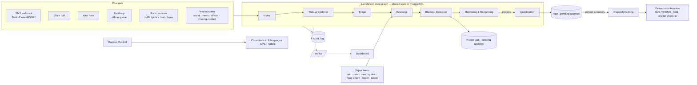

# RELAY — Resilient Emergency Logistics & Adaptive Yield

**AgentX Hackathon 2026 (Hack4Hack) · PS-03 Multi-Agent Disaster Response Coordinator · Agentic AI track · Team Tech Architects**

RELAY turns fragmented, duplicate, unverified and **multilingual** emergency reports — arriving over the internet *and*
over SMS, voice calls and radio — into evidence-backed, **human-approved** relief plans. It tracks every delivery until
someone confirms it arrived, replans when conditions change, and treats **silence as a signal**: populated places that
stop reporting inside the hazard footprint are found and visited.

> Reports arrive (any channel, any language) → duplicates grouped → evidence verified & confidence scored → needs
> triaged → shortages detected → allocation plan recommended → **a person approves** → dispatch tracked → delivery
> confirmed → the system replans when something changes.

The demo scenario is set in **Kodagu (Coorg), Karnataka** — a real flood- and landslide-prone district. Coordinates
are real; **every report, person, stock count and incident is synthetic**, and every screen says so.

---

## Run it

### One command (Docker)

```bash
cp .env.example .env
docker compose up --build
```

Dashboard **http://localhost:5180** · API docs **http://localhost:8010/docs** · PostgreSQL + PostGIS on 5432.
The backend runs Alembic migrations and auto-seeds the scenario on first start.

### Without Docker

The backend falls back to a local SQLite file when `DATABASE_URL` is not PostgreSQL (same SQLAlchemy models, portable
SQL: JSON columns, lat/lng + haversine, no PostGIS functions).

```bash
cd backend
python -m venv .venv && .venv/Scripts/activate        # macOS/Linux: source .venv/bin/activate
pip install -r requirements.txt
python -m uvicorn app.main:app --port 8010              # auto-seeds on first start

cd ../frontend
npm install
npm run dev                                             # http://localhost:5180 (proxies /api and /ws to :8010)
```

| Command | What it does |
|---|---|
| `make up` | `docker compose up --build` |
| `make test` | backend `pytest` (67 tests) + frontend `vitest` |
| `make seed` | reset the database and replay the scenario to T+12 h |
| `make eval` | run the evaluation, print metrics, write `backend/eval/results.json` |

(`make` is optional; each target is a one-line command in the `Makefile`.)

### Mock mode vs real mode

| | Mock mode (default, no keys) | Real mode |
|---|---|---|
| Switch | `RELAY_MOCK_MODE=true` or no `GEMINI_API_KEY` | `RELAY_MOCK_MODE=false` + `GEMINI_API_KEY` |
| Extraction | rule-based multilingual extractor (keyword lists per language, regex, number words) | Gemini with a strict JSON schema, validated by Pydantic; rules on failure |
| Translation | translation memory (verified translations) → word-by-word glossary, with confidence | Gemini, kept beside the original |
| Embeddings | local character n-gram embedding of a language-neutral form | Gemini multilingual embeddings on the raw text |
| Voice | browser speech recognition / typed transcript / provider transcript | Gemini audio transcription |
| SMS | built-in simulator (mock provider, outbox in the DB) | Twilio adapter (Exotel/MSG91 use the same interface) |
| Geocoding | multilingual gazetteer | gazetteer → OpenStreetMap Nominatim |
| Assistant | rule-based explanations + live facts | Gemini writes the answer in the UI language from the same facts |
| Drone image check | stored for human review | Gemini vision (experimental) |

---

## Architecture



| Component | Question it answers | What it does |
|---|---|---|
| **Intake Agent** | What is this report saying? | Language + script detection (native / romanized / mixed), translation kept beside the original, extraction from the original text, gazetteer geocoding, clarification SMS in the reporter's language, voice transcription |
| **Trust & Evidence Agent** | Is it true, and have we seen it before? | Cross-lingual duplicate clustering (similarity AND distance AND time AND compatible needs), forwards count once, 7-component confidence score with penalties, Fast Verify queue, source reliability updates |
| **Triage Agent** | Who needs help first? | Priority /100 with a reason per component; unverified life-safety reports keep their weight |
| **Resource Agent** | Do we have enough, and where? | Reachable supply vs demand (Sphere: 15 L water / person / day), burn-rate forecasts, transfers, escalation, stale stock |
| **Coordination Agent** | Who goes where, with what, and did it arrive? | Greedy allocation with reasons and evidence, approve / edit / reject, dispatch tracking, delivery confirmation, overdue escalation |
| Monitoring & Replanning | Has something changed? | Shelter inaccessible / full / unconfirmed, roads flooded, new high-priority incidents, shortages, failed deliveries → new plan for approval |
| Blackout Detection | Which areas have gone silent? | Hazard × population × silence × infrastructure × missing-contact × vulnerability; recon task with pre-positioned supplies |
| Rumour Control | What do people need to know is false? | Corrections pre-translated into 8 languages with place names in each script; SMS + public page |
| Digital Twin | What if…? | 3 scenarios, timeline replay with a clock, what-if events, 12-step Run Demo, live 3D twin |

**Repository:** `backend/app/{agents,graph,channels,i18n,services,sim,api,models,ws,core}`, `backend/{tests,eval,migrations}`,
`frontend/src/{pages,components,hooks,services,i18n}`. `PROGRESS.md` records every phase and decision.

### Multilingual by design

8 languages (English, Kannada, Hindi, Malayalam, Tamil, Telugu, Marathi, Bengali) configured in
`backend/app/i18n/languages.json` — adding a language is configuration plus its lexicon entries. Native script,
romanized (Kanglish, Hinglish, Manglish…) and code-mixed text are handled. The original text is never discarded;
extraction runs on the original, translation is for display with its method and confidence. SMS replies, clarification
questions, delivery confirmations and rumour corrections go out in the reporter's language. The dashboard UI switches
between English, ಕನ್ನಡ and हिंदी.

### "Explain me" everywhere

Every page header and panel has an **Explain me** button. It opens an assistant that explains that part of the screen
(what it is, how to read it, what you can do) with live facts from the current situation, and takes follow-up
questions. It is read-only.

---

## The demo (Run Demo button on *Scenario control*)

1. Reports arrive over web, social and SMS in several languages.
2. Duplicates grouped — a Kannada SMS and an English post about Karadigodu become one incident.
3. "Harangi dam has burst, share to all" is contradicted by the dam bulletin → false → correction in 8 languages.
4. Urgent requests are prioritised with visible reasons.
5. Projected shortage: water at Napoklu camp runs out in ~24 h.
6. The Coordination agent recommends a plan with reasons and evidence.
7. **A person approves** (the demo waits).
8. Dispatches move on the map.
9. The Napoklu camp manager replies **ಹೌದು** (yes) by SMS → delivery confirmed, stock moves.
10. Internet goes down in Kushalnagar → web/social stop, SMS still arrives → blackout alert for a silent zone.
11. Flood water covers the roads to Siddapura camp → inaccessible → new plan awaits approval.
12. Hattihole (2,400 people) sent zero reports; RELAY ranks it top of the silent zones and proposes a recon team with
    supplies → **a person approves** → a satellite-phone report turns the village into normal incidents.

See `DEMO.md` for the rehearsal checklist.

---

## Evaluation (`make eval`, Metrics page)

**Evaluated on synthetic data; real-world validation pending.** Two sets, reported separately: the *development* set
(the 82 seed reports the rules were built against — optimistic) and a *held-out* set (29 reports written after tuning,
never used to tune; adds Telugu, Marathi and Bengali).

| Metric (held-out unless noted) | Result |
|---|---|
| Duplicate detection, pairwise | precision 1.00 · recall 0.95 (per language on the Metrics page) |
| Extraction accuracy | location 0.85 · need type 0.95 · people count (±15%) 0.80 |
| Fake / true (incident level) | 2 of 2 rumours detected, 0 false alarms (risk scoring, not proof) |
| Time to a feasible plan | 0.27 s mean (seed scenario) |
| Evidence traceability | 100% of plan lines link to reports or a forecast |
| Shortage detection | 6 / 6 injected shortages |
| Delivery verification | 8 / 13 deliveries confirmed (the rest have no recipient phone and wait for a field or check-in confirmation; replies are simulated) |

---

## Research grounding

- Gopal et al. 2026 (NHESS) reviewed 250 studies: only ~7% addressed resource identification, ~6% handled regional
  (non-English) languages, ~95% relied on Twitter; only 1–3% of tweets are geotagged (Imran et al. 2020).
- Mehta et al. 2017: more than 75% of US emergency agencies won't act on social-media information unless another
  trusted source verifies it.
- Bharosa et al. 2010: responders distrust and ignore systems that are hard to use or not explainable.

RELAY targets these gaps: multilingual and offline intake, verification, resource matching and closed-loop delivery.

## Human in the loop, explainability, fairness

- Nothing is dispatched without a person's approval; recon tasks need approval too. Every agent action and human
  decision is in the audit log with inputs and outputs.
- Every score (confidence, priority, blackout risk, shortage) is stored with its components and reasons and shown in
  the UI. Thresholds and weights live in one file: `backend/app/services/scoring.py`.
- Blackout detection keeps silent, low-connectivity places from being deprioritised just because they report less.

## Privacy and data retention

- Phone numbers are stored only as salted SHA-256 hashes (to recognise repeat senders and match replies) plus a masked
  form for display (`+91 98XXXXX210`). Raw numbers are held only in memory to reply; real providers reply within the
  conversation.
- Reporter identities are not shown beyond the masked number; the public page shows only official corrections.
- Retention policy (proposed for deployment): raw report text and audio kept for 90 days after the event closes, then
  deleted; aggregated incidents and the audit log kept for after-action review; phone hashes deleted with their reports.
  Data is used only for relief coordination.

## Known limitations

- Fake-detection is risk scoring, not proof; it can be wrong. People confirm or refute.
- Real deployment needs telecom provider integration, real inventory feeds and official data access (IMD, CWC,
  NRSC/Sentinel-1, telecom and power outage feeds are mocked here).
- Metrics are on synthetic data until validated on real incidents.
- Translation and extraction quality varies by language and dialect; low-resource dialects need further testing. In mock
  mode, unseen text is translated word-by-word (shown with low confidence); Kodava, Tulu and Konkani are not supported.
- Blackout detection depends on hazard, population and outage data being available; satellite and outage feeds are
  mocked in the demo.
- Drone-image SOS detection is experimental.
- The dashboard chrome is translated into English, Kannada and Hindi; detailed panel text and assistant explanations
  stay in English in mock mode.
- Docker Compose and PostgreSQL were written for one-command start but were not run on the build machine (no Docker
  there); development and tests ran on the SQLite fallback with the same models.
- A third-party import notice from LangGraph (`allowed_objects`) appears in the test output; it is not from RELAY.
